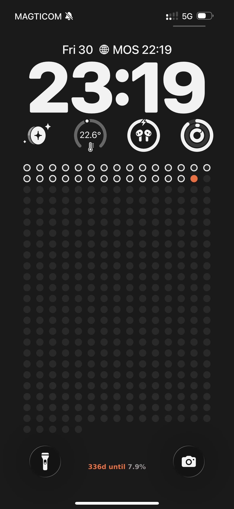
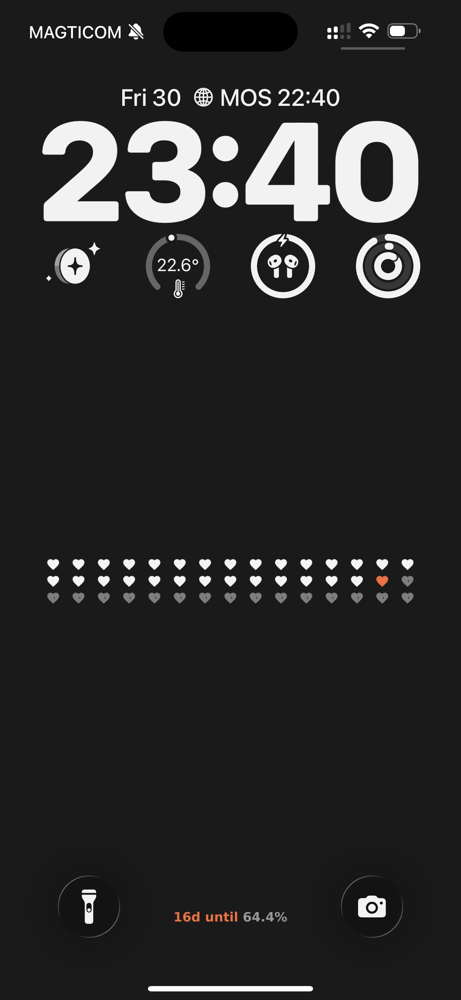
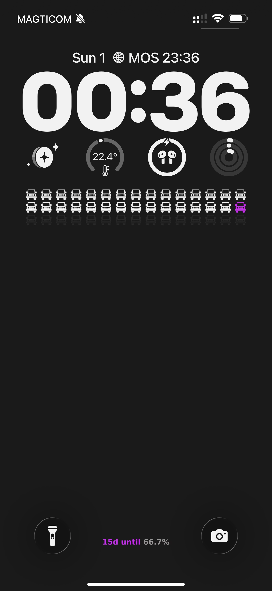

# Until Wall

**[Read in English](#english) | [Читать на русском](#русский)**

---

Life calendar wallpaper generator for Apple devices (iPhone, iPad, Mac).

Generate personalized life calendar wallpapers that visualize your life journey with beautiful circles - each representing one **day** of your life.

## Preview

<table>
  <tr>
    <td></td>
    <td></td>
    <td></td>
    <td></td>
  </tr>
  <tr>
    <td align="center"><b>Goal Feature</b><br/><small>Multiline text support</small></td>
    <td align="center"><b>Visual Styles</b><br/><small>Multiple styles available</small></td>
    <td align="center"><b>Device Customization</b><br/><small>iPhone, iPad, Mac</small></td>
    <td align="center"><b>Widget Support</b><br/><small>Reserve space for widgets</small></td>
  </tr>
</table>

---

<a name="english"></a>

## Features

- 🎨 **Multiple Visual Styles** - Solid circles, elegant rings, hearts, emojis, animals, and more (for your precious hearts ❤️)
- 📱 **Multi-Device Support** - Optimized presets for iPhone, iPad, and Mac with device-specific overlays
- 🎯 **Widget Compatible** - Reserve space for iOS widgets at the top
- 🖼️ **High Resolution** - Crisp output for Retina displays at device native resolutions
- 📊 **Progress Tracking** - See days remaining, life percentage, and current day highlighted
- 🌗 **Dark Theme** - Perfect for OLED screens with high contrast
- 💾 **Settings Persistence** - Your preferences are saved automatically
- 🔗 **iOS Shortcuts Integration** - Generate wallpapers directly from your iPhone
- 📲 **Responsive Design** - Works seamlessly on mobile and desktop

## Tech Stack

- **Next.js 15** - React framework with App Router
- **TypeScript** - Type-safe development
- **Tailwind CSS** - Utility-first styling
- **Sharp** - High-performance image processing
- **Docker** - Containerized deployment

### Rust Backend (experimental)

An alternative backend lives in [`rust/`](rust/) with the same API contract
(`Dockerfile.rust`, multi-stage: static UI export → cargo test+build → slim
alpine runtime). It generates **byte-identical SVG** responses and
dimension-identical PNGs; `tests/golden/` holds reference captures from the
Next.js image and `cargo test` replays them. See
[CLAUDE_CONTEXT.md](CLAUDE_CONTEXT.md) for details.

```bash
# Build and run on http://127.0.0.1:3110
docker compose -f compose.rust.yaml up -d --build
```

## Quick Start

### Using Docker
```bash
# Clone the repository
git clone https://github.com/0x3654/untilwall.git
cd untilwall

# Start the container
docker compose up -d

# Open http://localhost:3000
```

### Local Development

```bash
# Clone the repository
git clone https://github.com/0x3654/untilwall.git
cd untilwall

# Build and start (builds with same name as compose.yaml for local priority)
docker build -t 0x3654/untilwall:latest -f src/Dockerfile src/ && docker compose up -d

# View logs
docker compose logs -f

# Open http://localhost:3000

# Rebuild and restart after code changes
docker build -t 0x3654/untilwall:latest -f src/Dockerfile src/ && docker compose up -d
```

This builds the image with the same name as specified in `compose.yaml`, ensuring your locally built image takes priority over the remote one.

## Configuration

### Setting Application URL

The application needs to know its public URL to generate correct links for the iOS Shortcuts integration.

**For Docker deployment:**

1. Copy `.env.example` to `.env`:
   ```bash
   cp .env.example .env
   ```

2. Edit `.env` and set your URL:
   ```bash
   # Local development
   NEXT_PUBLIC_APP_URL=http://localhost:3000

   # Local network IP
   NEXT_PUBLIC_APP_URL=http://192.168.1.10:3000

   # Production domain
   NEXT_PUBLIC_APP_URL=https://untilwall.app.example
   ```

3. Restart the container:
   ```bash
   docker compose up -d
   ```

**For production deployment (GitHub Actions, etc.):**

Set the `NEXT_PUBLIC_APP_URL` environment variable in your deployment platform:

```yaml
# Example: GitHub Actions
env:
  NEXT_PUBLIC_APP_URL: https://your-domain.com
```

**For Docker Hub / Registry:**

The `.env` file is gitignored, so users can configure their own URL. Document this in your deployment instructions.

## Usage

### Web Interface

1. **Select Device** - Choose your Apple device from presets
2. **Set Date Range** - Enter your birth date and life expectancy
3. **Customize** - Adjust dot style, widget space, footer text display, colors, offsets
4. **Get shortscut** - Click "Get shortscut" to setup autorenew wallpaper every day.
5. **HELP** - If you need help press button "HELP!!!"


## Device Presets

### iPhone
- iPhone 15 Pro Max / Plus (1290×2796)
- iPhone Xs (1125×2436)
- iPhone Duo Inner 7.6" (1878×2670) - foldable, main display
- iPhone Duo Outer 5.4" (1398×2034) - foldable, cover display

### iPad
- iPad Pro 12.9" Portrait (2048×2732)

### Mac
- MacBook Air 13" (2560×1664)

*More devices can be added easily in `types/index.ts`*

## API Endpoints

### `GET /goal`

Generate PNG/SVG calendar image.

**All parameters are optional** - the API will use sensible defaults if not provided.

**Parameters:**

| Parameter | Type | Default | Description |
|-----------|------|---------|-------------|
| `start_date` | string | `2000-01-01` | Start date in ISO format (YYYY-MM-DD) |
| `end_date` | string | `2080-01-01` | End date in ISO format (YYYY-MM-DD) |
| `width` | integer | `1290` | Image width in pixels |
| `height` | integer | `2796` | Image height in pixels |
| `offset_top` | float | `0` | Top safe area offset (percentage, 0-50) |
| `offset_bottom` | float | `0` | Bottom safe area offset (percentage, 0-50) |
| `offset_left` | float | `0` | Left safe area offset (percentage, 0-50) |
| `offset_right` | float | `0` | Right safe area offset (percentage, 0-50) |
| `ring_style` | integer | `1` | Dot style: 0=Ring, 1=Solid, 2=Hearts, 3=Poop, 4=Piggy, 5=Money, 6=Dachshund, 7=Cat, 8=Paw, 9=Emo, 10=Gold, 11=Pink G-Wagen |
| `dot_scale` | float | `1.0` | Dot size multiplier (0.5-2.0) |
| `show_text` | string/integer | `1` | Show bottom text: `1` or `true` = show, `0` = hide |
| `has_widgets` | string/boolean | `false` | Reserve 15% height for widgets: `true` or `1` = yes |
| `theme` | string | `dark` | Color theme (currently only `dark` supported) |
| `bg_color` | string | `#1a1a1a` | Background color (hex) |
| `past_color` | string | `#ffffff` | Past days color (hex) |
| `current_color` | string | `#ff6b35` | Current day color (hex) |
| `future_color` | string | `#2a2a2a` | Future days color (hex) |
| `format` | string | `png` | Output format: `png` for download, `svg` for faster preview |
| `html` | boolean | `false` | Return HTML page with centered image (for debugging) |
| `tz` | string | server `TZ` | Timezone offset for the day boundary, signed hours from UTC (`-5`, `0`, `+3`, `+5.5`); when absent the container `TZ` applies (Rust backend) |

**Examples:**

```bash
# Minimal URL - uses all defaults
GET /goal

# iPhone 15 Pro Max with custom dates
GET /goal?start_date=1990-01-01&end_date=2070-01-01&width=1290&height=2796

# Custom colors and spacing
GET /goal?bg_color=%23000000&past_color=%23ff0000&offset_top=10&offset_bottom=10

# Preview with SVG format (faster)
GET /goal?width=1290&height=2796&format=svg

# Full example with all parameters
GET /goal?start_date=1990-01-01&end_date=2070-01-01&width=1290&height=2796&ring_style=1&dot_scale=1.0&show_text=1&has_widgets=0&offset_top=0&offset_bottom=0&offset_left=0&offset_right=0&bg_color=%231a1a1a&past_color=%23ffffff&current_color=%23ff6b35&future_color=%232a2a2a
```

**Notes:**
- All parameters are optional - you can use `/goal` with no parameters for a working default wallpaper
- Only `width` and `height` are required for device-specific output
- Use `format=svg` for faster previews (lower quality)
- The API returns PNG by default (high quality for wallpapers)

## Configuration

### Adding New Devices

Edit `types/index.ts` to add device presets:

```typescript
{
  name: 'Device Name',
  width: 1290,
  height: 2796,
  type: 'iphone',
  orientation: 'portrait',
  circleSize: 56,
  circleGap: 24,
  padding: 20,
  defaultSafeArea: { top: 22, bottom: 25, left: 10, right: 10 }
}
```

### Device Overlays

Place device overlay images in `public/overlay/`:
- `{device}.png` - Without widget space
- `{device}_widget.png` - With widget space

Example: `15promax.png` / `15promax_widget.png` (iPhone 15 Pro Max)

## Deployment

### Docker

```bash
docker compose up -d --build
```

### Environment Variables

- `NODE_ENV` - Set to `production` for deployment
- `NEXT_PUBLIC_APP_URL` - Public URL for generating links (IMPORTANT for iOS Shortcuts)

**Setting NEXT_PUBLIC_APP_URL in CI/CD:**

**GitHub Actions:**
```yaml
- name: Deploy
  run: |
    echo "NEXT_PUBLIC_APP_URL=https://untilwall.0x3654.com" >> $GITHUB_ENV
  env:
    NEXT_PUBLIC_APP_URL: https://untilwall.0x3654.com
```

**Docker Compose (production):**
```yaml
services:
  untilwall:
    env_file:
      - .env
    environment:
      - NEXT_PUBLIC_APP_URL=${APP_URL:-https://untilwall.0x3654.com}
```

Then deploy with:
```bash
export APP_URL=https://untilwall.0x3654.com
docker compose up -d --build
```

### Local Build

```bash
# From project root - build context is src/
docker build -t 0x3654/untilwall:latest -f src/Dockerfile src/

# Run container
docker run -p 3000:3000 --env-file .env 0x3654/untilwall:latest
```

⚠️ **Important:** Source files are in the `src/` directory. The build context is `src/`.

## Project Structure

```
untilwall/
├── app/              # Next.js app router
│   ├── page.tsx      # Main UI
│   └── goal/         # API route for image generation
├── components/       # React components
├── public/           # Static assets
│   └── overlay/      # Device overlay images
├── types/            # TypeScript definitions
├── Dockerfile        # Docker image
└── compose.yaml      # Docker compose config
```

## License

MIT License - see [LICENSE](LICENSE) for details.

**Copyright (c) 2026 0x3654**

Free to use, modify, and distribute. Attribution required in copies.

## Author

**0x3654** - [GitHub](https://github.com/0x3654)

## Acknowledgments

Design and concept inspired by [The Life Calendar](https://www.thelifecalendar.com).

Originally popularized by Tim Urban's ["Your Life in Weeks"](https://waitbutwhy.com/2014/05/life-weeks.html) post on the "Wait But Why" blog.

---

<a name="русский"></a>

# Until Wall

**[Read in English](#english) | [Читать на русском](#русский)**

---

Генератор календарных обоев для устройств Apple (iPhone, iPad, Mac).

Создавайте персонализированные календарные обоева, которые визуализируют ваш жизненный путь красивыми кругами — каждый представляет один **день** вашей жизни.

## Превью

<table>
  <tr>
    <td></td>
    <td></td>
    <td></td>
    <td></td>
  </tr>
  <tr>
    <td align="center"><b>Функция Goal</b><br/><small>Многострочный текст</small></td>
    <td align="center"><b>Визуальные стили</b><br/><small>Множество стилей</small></td>
    <td align="center"><b>Кастомизация</b><br/><small>iPhone, iPad, Mac</small></td>
    <td align="center"><b>Виджеты</b><br/><small>Место для виджетов</small></td>
  </tr>
</table>

## Возможности

- 🎨 **Множество визуальных стилей** - Заполненные круги, элегантные кольца, сердечки, эмодзи, животные и многое другое (для ваших дорогих сердечек ❤️)
- 📱 **Поддержка множества устройств** - Оптимизированные пресеты для iPhone, iPad и Mac с оверлеями под конкретные устройства
- 🎯 **Совместимость с виджетами** - Резервируйте место для iOS iPadOS виджеты
- 🖼️ **Высокое разрешение** - Четкий вывод для Retina дисплеев в родном разрешении устройства
- 📊 **Отслеживание прогресса** - Видите оставшиеся дни, процент и текущий день
- 💾 **Сохранение настроек** - Ваши предпочтения сохраняются автоматически
- 🔗 **Интеграция с iOS Shortcuts** - Обновляет обои в фоне каждый день прямо с iPhone

## Технологии

- **Next.js 15** - React фреймворк с App Router
- **TypeScript** - Разработка с типизацией
- **Tailwind CSS** - Utility-first стилизация
- **Sharp** - Высокопроизводительная обработка изображений
- **Docker** - Контейнеризация

## Быстрый старт

### Использование Docker (Рекомендуется)

```bash
# Клонируйте репозиторий
git clone https://github.com/0x3654/untilwall.git
cd untilwall

# Запустите контейнер
docker compose up -d

# Откройте http://localhost:3000
```

### Локальная разработка

```bash
# Клонируйте репозиторий
git clone https://github.com/0x3654/untilwall.git
cd untilwall

# Соберите и запустите (собирает с тем же именем что в compose.yaml для приоритета локальной версии)
docker build -t 0x3654/untilwall:latest -f src/Dockerfile . && docker compose up -d

# Просмотр логов
docker compose logs -f

# Откройте http://localhost:3000

# Пересоберите и перезапустите после изменений в коде
docker build -t 0x3654/untilwall:latest -f src/Dockerfile . && docker compose up -d
```

Это собирает образ с тем же именем что указан в `compose.yaml`, что обеспечивает приоритет вашей локальной сборки над удаленной.

## Конфигурация

### Настройка URL приложения

Приложению нужно знать свой публичный URL для генерации правильных ссылок для интеграции с iOS Shortcuts.

**Для Docker развертывания:**

1. Скопируйте `.env.example` в `.env`:
   ```bash
   cp .env.example .env
   ```

2. Отредактируйте `.env` и установите ваш URL:
   ```bash
   # Локальная разработка
   NEXT_PUBLIC_APP_URL=http://localhost:3000

   # Локальный IP
   NEXT_PUBLIC_APP_URL=http://10.0.1.166:3000

   # Продакшн домен
   NEXT_PUBLIC_APP_URL=https://untilwall.0x3654.com
   ```

3. Перезапустите контейнер:
   ```bash
   docker compose up -d
   ```

**Для продакшн развертывания (GitHub Actions и т.д.):**

Установите переменную окружения `NEXT_PUBLIC_APP_URL` в вашей платформе деплоя:

```yaml
# Пример: GitHub Actions
env:
  NEXT_PUBLIC_APP_URL: https://your-domain.com
```

**Для Docker Hub / Registry:**

Файл `.env` находится в .gitignore, поэтому пользователи могут настроить свой URL. Задокументируйте это в инструкциях по развертыванию.

## Использование

### Веб-интерфейс

1. **Выберите устройство** - Выберите ваше устройство Apple из пресетов
2. **Установите даты** - Введите дату рождения и конечную дату
3. **Настройте** - Выберите стиль (Solid/Ring/Hearts), место для виджетов и отображение текста
4. **Сгенерируйте** - Нажмите "Download Wallpaper" для сохранения обоев
5. **Примените** - Установите как обои на вашем устройстве

### Интеграция с iOS Shortcuts

Автоматически генерируйте и обновляйте обои без открытия приложения:

1. Нажмите **"1. get link"** - копирует вашу персонализированную конфигурацию в буфер обмена
2. Нажмите **"2. Get shortcut"** - открывает ссылку iCloud Shortcuts
3. Добавьте ярлык на ваш iPhone
4. Запустите ярлык - он сгенерирует обои и предложит сохранить их
5. Установите как обои и наслаждайтесь!

Ваши настройки сохраняются автоматически, поэтому ярлык всегда использует ваши последние предпочтения.

## Визуальные стили

### Solid (Заполненные)
- Прошедшие дни: Заполненные белые круги ⚪
- Текущий день: Оранжевый круг 🟠
- Будущие дни: Серые круги ⚫

### Ring (Кольца)
- Прошедшие дни: Белые кольца с обводкой ⭕
- Текущий день: Оранжевое заполненное кольцо 🟠
- Будущие дни: Серые кольца с обводкой ⚫

### Hearts (Сердечки)
- Прошедшие дни: Белые сердечки ❤️
- Текущий день: Оранжевое заживляющее сердечко ❤️‍🩹
- Будущие дни: Серые разбитые сердечки 💔

*Каждый круг/сердечко представляет один **день** вашей жизни*

## Пресеты устройств

### iPhone
- iPhone 15 Pro Max / Plus (1290×2796)
- iPhone Xs (1125×2436)
- iPhone Duo Inner 7.6" (1878×2670) - foldable, main display
- iPhone Duo Outer 5.4" (1398×2034) - foldable, cover display

### iPad
- iPad Pro 12.9" Portrait (2048×2732)

### Mac
- MacBook Air 13" (2560×1664)

*Больше устройств можно легко добавить в `types/index.ts`*

## API эндпоинты

### `GET /goal`

Генерирует PNG изображение календаря.

**Параметры:**
- `start_date` - Начальная дата (формат ISO)
- `end_date` - Конечная дата (формат ISO)
- `width` - Ширина изображения в пикселях
- `height` - Высота изображения в пикселях
- `offset_top` - Верхний отступ безопасной зоны (%)
- `offset_bottom` - Нижний отступ безопасной зоны (%)
- `offset_left` - Левый отступ безопасной зоны (%)
- `offset_right` - Правый отступ безопасной зоны (%)
- `ring_style` - Стиль: 0=Ring (кольца), 1=Solid (заполненные круги), 2=Hearts (сердечки), 3=Poop, 4=Piggy, 5=Money, 6=Dachshund, 7=Cat, 8=Paw, 9=Emo, 10=Gold, 11=Pink G-Wagen
- `show_text` - 1 = показывать текст, 0 = скрыть
- `has_widgets` - Резервировать 15% высоты для виджетов (0 или 1)
- `theme` - Тема (сейчас: dark)

**Пример:**
```
GET /goal?start_date=1990-01-01&end_date=2070-01-01&width=1290&height=2796&ring_style=1&show_text=1
```

## Конфигурация

### Добавление новых устройств

Отредактируйте `types/index.ts` для добавления пресетов устройств:

```typescript
{
  name: 'Device Name',
  width: 1290,
  height: 2796,
  type: 'iphone',
  orientation: 'portrait',
  circleSize: 56,
  circleGap: 24,
  padding: 20,
  defaultSafeArea: { top: 22, bottom: 25, left: 10, right: 10 }
}
```

### Оверлеи устройств

Поместите изображения оверлеев в `public/overlay/`:
- `{device}.png` - Без места для виджетов
- `{device}_widget.png` - С местом для виджетов

Пример: `15promax.png` / `15promax_widget.png` (iPhone 15 Pro Max)

## Развертывание

### Docker

```bash
docker compose up -d --build
```

### Переменные окружения

- `NODE_ENV` - Установите в `production` для продакшена
- `NEXT_PUBLIC_APP_URL` - Публичный URL для генерации ссылок (ВАЖНО для iOS Shortcuts)

**Настройка NEXT_PUBLIC_APP_URL в CI/CD:**

**GitHub Actions:**
```yaml
- name: Deploy
  run: |
    echo "NEXT_PUBLIC_APP_URL=https://untilwall.0x3654.com" >> $GITHUB_ENV
  env:
    NEXT_PUBLIC_APP_URL: https://untilwall.0x3654.com
```

**Docker Compose (production):**
```yaml
services:
  untilwall:
    env_file:
      - .env
    environment:
      - NEXT_PUBLIC_APP_URL=${APP_URL:-https://untilwall.0x3654.com}
```

Затем разверните с:
```bash
export APP_URL=https://untilwall.0x3654.com
docker compose up -d --build
```

## Структура проекта

```
untilwall/
├── app/              # Next.js app router
│   ├── page.tsx      # Основной UI
│   └── goal/         # API роут для генерации изображений
├── components/       # React компоненты
├── public/           # Статические файлы
│   └── overlay/      # Оверлеи устройств
├── types/            # TypeScript определения
├── Dockerfile        # Docker образ
└── compose.yaml      # Docker compose конфиг
```

## Лицензия

MIT License - см. [LICENSE](LICENSE) для деталей.

**Copyright (c) 2026 0x3654**

Свободное использование, модификация и распространение. Требуется указание авторства в копиях.

## Автор

**0x3654** - [GitHub](https://github.com/0x3654)

## Благодарности

Дизайн и концепция вдохновлены сайтом [The Life Calendar](https://www.thelifecalendar.com).

Изначально популяризировано в блоге Тима Урбана "Wait But Why" постом ["Your Life in Weeks"](https://waitbutwhy.com/2014/05/life-weeks.html) (Твоя жизнь в неделях).

